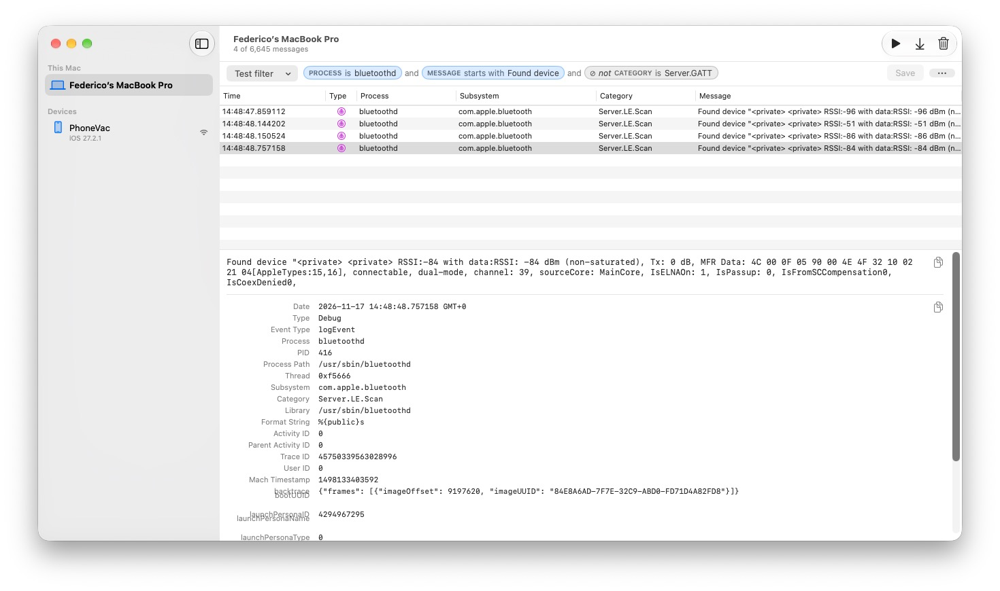
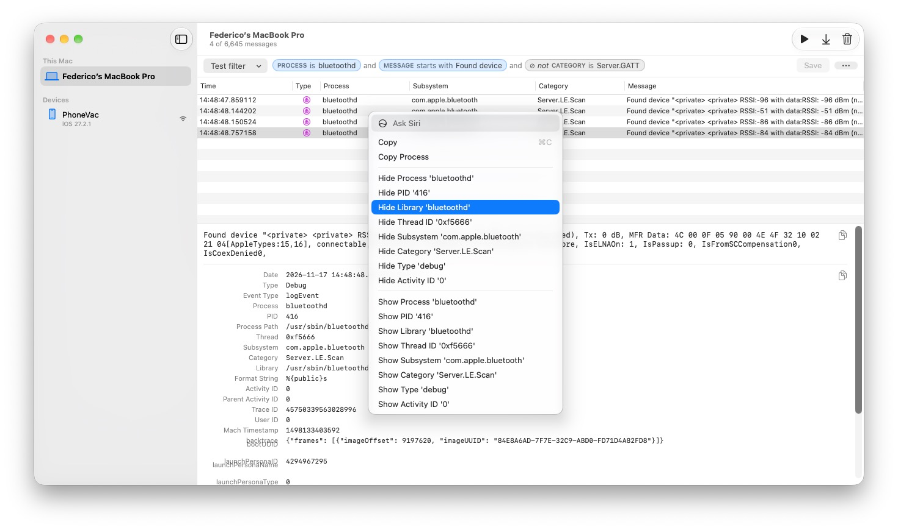
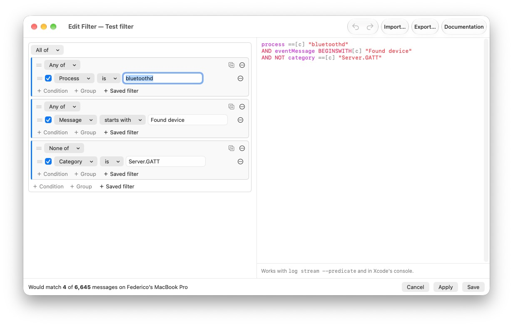
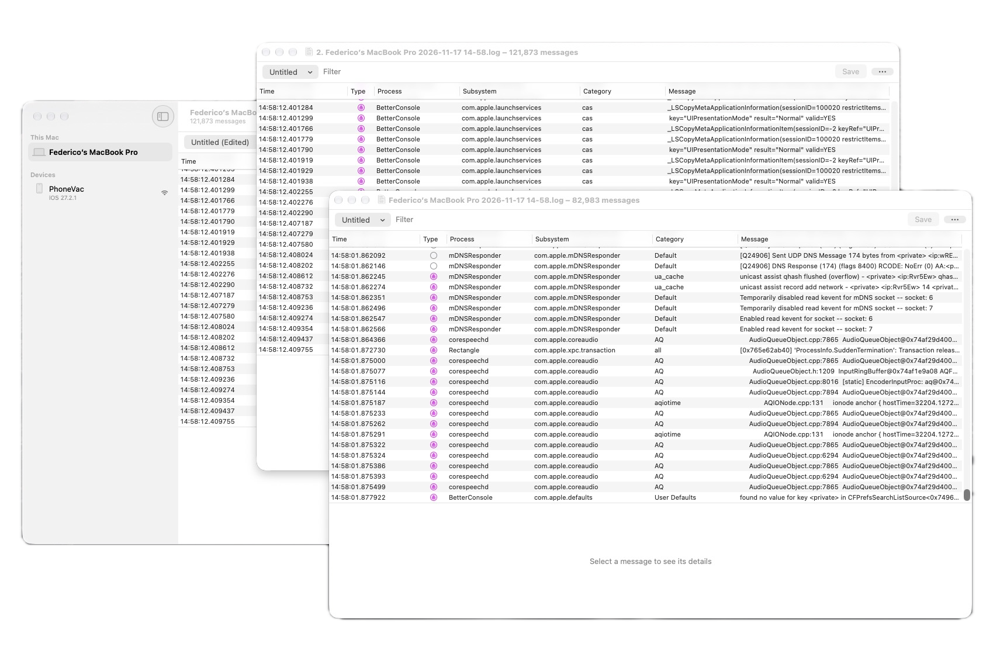

# BetterConsole

**Console.app's log stream, with filters you can actually read, write, save and share.**

BetterConsole is a macOS log viewer for developers. It streams live logs from your Mac, booted
simulators, and iPhones and iPads over USB or Wi‑Fi, and opens log files too. It does one thing
Console.app does, streaming logs, and does it a lot better.



## Why BetterConsole

I spend a lot of my day in Console.app, watching my Mac, a simulator and the phone on my desk.
Streaming works fine. Filtering is where the time goes: rebuilding the same queries by hand, a
one-line search field that scrolls out of sight, never knowing whether two tokens mean AND or OR,
saved searches I can't read or share, and rules like "this process and this subsystem, but no
debug messages" that are hard or impossible to express.

BetterConsole keeps what Console gets right (the token field and right‑click Show/Hide) and
fixes the rest.



## Better than Console

### 🔎 Filtering

- **See how your filter combines.** Every pair of bubbles says **or**, **and** or **not**.
  No more guessing.
- **Filters that wrap, not scroll.** Long filters flow onto several lines, all visible at once.
- **A real filter editor.** Nested groups (All of, Any of, None of, Not all of) in a visual
  builder, side by side with the same filter as text. Edit either; the other follows.
- **Regex on any field.** Process, subsystem, message, PID, even Type.
- **Compare, don't just match.** `Type at least Error`, `PID > 500`, time ranges like
  `21:45:30–21:46:00`, even across midnight.
- **Switch conditions off** with a checkbox instead of deleting them.
- **Live preview.** "Would match 1,204 of 98,310 messages" updates as you type.
- **Reuse filters inside filters.** Link a saved "Noise" filter wherever you need it; edit it once,
  everything follows.
- **Undo everything.** ⌘Z works across the builder, the text and imports.



Everything the editor can do is in the [filter editor documentation](App/Resources/FilterEditorHelp.html),
also built into the app under **Help ▸ Editor Documentation**.

### 🤝 Speaks Apple's language

- **Xcode and `log` predicate syntax.** The editor's text is the predicate language
  `log stream --predicate` and Xcode's console use.
- **Copy as log predicate.** One click gives you a command‑line ready predicate; parts only
  BetterConsole understands are highlighted and left out.

### 💾 Save and share

- **Filters are files.** Export as readable predicate text (`.bcfilter`) or JSON, keep them in a
  repo, send them to a colleague. Linked filters travel in the same file.
- **Named filters, one click away.** A dropdown of saved filters, with "(Edited)" when what you
  see isn't what's saved.
- **Each device remembers its filter.** Mac, simulator and phone each keep their own, across
  relaunches.

### 📱 Devices

- **iPhone and iPad over USB or Wi‑Fi.** USB first; unplug the cable mid-stream and it carries
  on over Wi‑Fi, in the same list, with no gap.
- **Simulators appear on their own** as you boot them.
- **Unplugged isn't gone.** A device's row and logs stay; streaming resumes when it's back.

### 📄 Log files

- **Save Logs (⌘S)** writes what's on screen, filter applied, to a `.log` file. No need to
  select everything first.
- **Open `.log` files** in their own window with the full filter toolbox. BetterConsole's own
  format, `log show` output, syslog, JSON lines and plain text are parsed into process,
  subsystem, category and message on a best‑effort basis.



### ⚡️ Fast, and honest under load

- **Tens of thousands of messages a second**, in an `NSTableView` built for it.
- **Filter changes never freeze the window.** Stored messages are re‑checked in the background,
  newest first, so what you're looking at appears first. Nothing is thrown away.
- **Dropped messages are counted**, never lost silently.
- **One memory cap you control** (default 4 GB); the oldest messages go first.

## At a glance

| | Console.app | BetterConsole |
|---|---|---|
| How tokens combine | Implicit | Shown between every bubble |
| Long filters | One scrolling line | Wrapping bubbles, plus a full editor |
| Nested rules (A and B) or C | ✗ | ✓ |
| Regex on any field | ✗ | ✓ |
| Type, number and time comparisons | ✗ | ✓ |
| Live match count while editing | ✗ | ✓ |
| Saved filters you can read and edit | ✗ | ✓ |
| Share filters as files | ✗ | ✓ `.bcfilter` / JSON |
| `log` / Xcode predicate syntax | ✗ | ✓ |
| Save visible logs to a file | Select all first | ⌘S |
| Open and filter `.log` files | ✗ | ✓ |
| Memory limit | No setting | One cap you set |

## A filter, written down

```
// BetterConsole filter
// version: 1
// name: DDG Errors
process ==[c] "DuckDuckGo"
AND messageType >= error
AND NOT filter == "Noise"

// filter: Noise
subsystem BEGINSWITH[c] "com.apple."
```

Readable, diff‑friendly, and (apart from the `filter ==` link) ready for
`log stream --predicate`.

## Sources

- **This Mac**, through `log stream`.
- **Booted simulators**, through `xcrun simctl spawn <device> log stream`.
- **iPhones and iPads**, over USB or Wi‑Fi, through Apple's private `MobileDevice.framework`,
  the same path Console.app uses. For Wi‑Fi, the device must be paired and have "Show this
  iPhone when on Wi‑Fi" (Finder) or "Connect via network" (Xcode) turned on. This code lives in
  a single module (`BCMobileDevice`) behind a protocol, so the transport can be swapped later.
- **Log files**, from File ▸ Open… (⌘O), Open Recent, or Open With in Finder.

## Requirements

- macOS 26 or later
- Xcode 27 with the iOS platform installed (for simulators)
- [XcodeGen](https://github.com/yonaskolb/XcodeGen) 2.46 or later, if you change `project.yml`

## Privacy

BetterConsole sends nothing anywhere. It talks only to your own devices: to iPhones and iPads
over Wi‑Fi it connects directly on your local network, so macOS asks for Local Network access
the first time. USB‑only use never needs it. Logs stay in memory and are gone when you quit,
unless you save them. Saved filters live in `~/Library/Application Support/BetterConsole/`
and leave that folder only when you export them.

## License

BetterConsole is licensed under the [Apache License 2.0](LICENSE). Use it, change it and share
it freely; copies and derivative works must keep the licence and the credit in [NOTICE](NOTICE).
